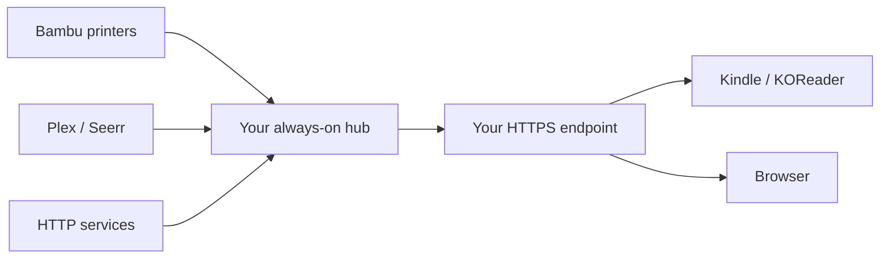

# Inkboard · Kindle Dashboard

A configurable, self-hosted dashboard for a jailbroken Kindle running KOReader,
with a browser interface for setup and everyday use. Connect only what you need:
Bambu printers, Plex/Seerr, or HTTP service checks. Credentials and device
configuration stay in your own private setup directory.

This is a portable community edition derived from a running Colorsoft dashboard.
It creates a new installation; it never upgrades another person's existing
dashboard or provisions access to anyone else's services.



## What works

| Module | Features | Required only when enabled |
| --- | --- | --- |
| Demo | Simulated printer data and rendered screens | Nothing beyond Python dependencies |
| Bambu | Status, temperatures, progress, snapshots; supported light/pause/resume/stop/speed controls | Printer LAN address, serial, access code, verified TLS identity; control support depends on firmware/settings |
| Plex | Libraries and Now Playing; playback/transcode/bandwidth observations | Your Plex URL and token |
| Seerr | Request/approval observations and supported operator actions | Your Seerr URL/key and authorized account |
| HTTP services | Named health checks, latency, availability and source freshness | Public HTTP/HTTPS URLs you choose |
| Alerts | Persistent source health notices with transient suppression and recovery | Enabled source modules |
| Kindle | Color UI, touch controls, Light, Health, cached offline views and authenticated Wi-Fi client updates | Supported jailbreak, KOReader, your HTTPS host and device-bound build |

The native printer page displays up to two selected printers. Modules are
independent; an offline source retains its last observation and loses control
capabilities without taking down the other modules. A Wi-Fi connection alone
does not mean source data is fresh.

The private deployment's AI Print Doctor/phone automation, GPU subtitles, drive
repair, whole-library deletion and origin traffic instrumentation are **not
automatically installed by this release**. Their native front doors are disabled
unless connected to a compatible separately configured backend. HTTP uptime
checks do not measure website visits. See the [feature and testing boundaries](docs/testing.md).

## 1. Start with the local demo

Install **Git** and **Python 3.11+**. No administrator access, printer, Plex account,
Kindle or domain is needed for this first check.

### Windows PowerShell

```powershell
git clone https://github.com/Kav-K/kindle-dashboard.git
cd kindle-dashboard
powershell -NoProfile -ExecutionPolicy Bypass -File .\tools\bootstrap.ps1 -Bambu
.\.venv\Scripts\inkboard.exe init --directory "$env:LOCALAPPDATA\Inkboard\demo" --demo
.\.venv\Scripts\inkboard.exe serve --directory "$env:LOCALAPPDATA\Inkboard\demo"
```

### macOS or Linux

```sh
git clone https://github.com/Kav-K/kindle-dashboard.git
cd kindle-dashboard
sh tools/bootstrap.sh --bambu
.venv/bin/inkboard init --directory ~/.config/inkboard/demo --demo
.venv/bin/inkboard serve --directory ~/.config/inkboard/demo
```

Open **http://127.0.0.1:8787/kindle-dashboard/**. In another terminal in the checkout, explicitly
display your demo's reader token and paste it into the page's local sign-in form:

```sh
# macOS/Linux; on Windows use .\.venv\Scripts\inkboard.exe and your directory.
.venv/bin/inkboard show-token --directory ~/.config/inkboard/demo --role reader
```

Do not share that token or put it in a URL. The browser shell is public; actual
dashboard data requires a reader/controller credential. Stop your owned demo
with Ctrl+C. If port 8787 is busy, use `serve ... --port 8788`; do not stop another
application to make room.

`init` refuses to overwrite an existing setup. To resume later, use `serve`, not
`init` again. Bootstrap similarly preserves an existing `.venv`.

## 2. Connect your own modules

Create a separate private home setup:

```powershell
# Windows, from the checkout
.\.venv\Scripts\inkboard.exe init --directory "$env:LOCALAPPDATA\Inkboard\home"
```

```sh
# macOS/Linux, from the checkout
.venv/bin/inkboard init --directory ~/.config/inkboard/home
```

Edit its `config.json` and add only the modules you want. Integration
secrets are named references to `secrets.json`; the config does not contain the
values. Set them through a hidden prompt:

```sh
.venv/bin/inkboard set-secret --directory ~/.config/inkboard/home --name plex-key
```

Then run an offline check, followed by an explicit read-only connection test:

```sh
.venv/bin/inkboard check --directory ~/.config/inkboard/home
.venv/bin/inkboard check --directory ~/.config/inkboard/home --connect
.venv/bin/inkboard serve --directory ~/.config/inkboard/home
```

Windows uses the equivalent `.venv\Scripts\inkboard.exe` commands and the chosen
`$env:LOCALAPPDATA\Inkboard\home` directory. Keep the setup directory outside
the repository. Each integration guide includes a complete module example,
credential locations, controls, limitations and troubleshooting:

- [Bambu printers](docs/integrations/bambu.md)
- [Plex and Seerr](docs/integrations/plex-seerr.md)
- [HTTP services](docs/integrations/http-status.md)
- [Write another integration](docs/modules.md)

## 3. Put the dashboard on your Kindle

Follow the [Kindle first-run guide](docs/kindle.md), in order:

1. Verify your exact model/firmware against the current upstream jailbreak guide.
2. Install and open KOReader once. Exit KOReader before connecting USB storage.
3. Give your hub a stable, trusted [HTTPS address](docs/remote-access.md).
4. Configure your own device serial and selected printer IDs. Build its private
   USB package with `tools/build_kindle.py` using your private config/secrets files.
5. Install the package as instructed, then open Inkboard in KOReader.
6. Publish only the generated token-free `client_updates` directory to your hub
   for later authenticated Wi-Fi updates. Keep the credential-bearing USB zip private.

This project does not jailbreak a Kindle or install Amazon firmware. There is
no universal safe jailbreak command for every current Kindle. Do not update its
firmware to try to resolve a dashboard problem. A dashboard client update is
separate from a Kindle OS update.

## 4. Keep it available

The hub must remain awake on a machine that can reach its sources. The Kindle
only needs your hub's HTTPS endpoint, including on another Wi-Fi or a hotspot;
it never needs direct access to the printer or media server.

- [Remote access, HTTPS and split collectors](docs/remote-access.md)
- [Start at boot and recover after a restart](docs/operations.md)
- [Update, backup and recover](docs/updates.md)
- [Security model](SECURITY.md)

Actions are durably recorded before dispatch. A lost acknowledgement is shown
as uncertain; it is never an instruction to resend automatically. Check the
actual device before creating a new command.

## Development and verification

```sh
python -m pip install -e '.[bambu,test]' build
python -m unittest discover -s tests -v
python tools/public_audit.py
python -m build
python tools/verify_setup.py --wheel-dir dist
```

The final command creates a fresh virtual environment, installs the actual
wheel, initializes a private demo, checks authentication/PNG output, restarts the
owned server, builds a synthetic per-device USB package and verifies every OTA
asset through the real HTTP routes. It contacts no printer, Plex server or paid
provider and registers no background service. Package installation needs normal
Python package-download access.

GitHub Actions runs these checks on Linux, Windows and macOS. See [testing](docs/testing.md)
for what those tests prove, hardware checks that remain separate, and clean-room
instructions. Contributions are welcome; start with [CONTRIBUTING.md](CONTRIBUTING.md).

GPL-3.0-or-later. See [LICENSE](LICENSE) and [third-party notices](THIRD_PARTY_NOTICES.md).
